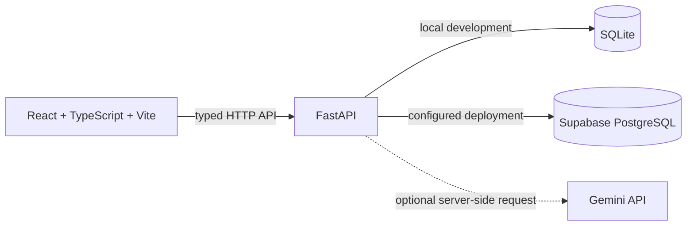

# CallGuide

CallGuide is a focused companion for a live cold call. It guides a caller through eight conversation stages, saves stage outcomes and the prospect's exact words, and keeps the final call outcome separate from the furthest stage reached.

## Product

- Eight stage-specific prompts and outcome choices.
- Optional prospect and company names when a call starts.
- Save-and-continue workflow with honest saving/error states and preserved drafts after a failed save.
- A final-outcome dialog available at every stage, with optional next-step details.
- Searchable and filterable call history backed by the API.
- Read-only call details timeline, including stages that were not reached.
- Optional Gemini response suggestions. A missing or failing AI provider does not block the call workflow.
- Warm off-white surfaces, forest green actions, muted sage selection states, Manrope headings, and compact live-call layout based on the supplied Stitch project.

No calls are preloaded. The History page starts empty until calls are saved.

## Screenshots

Screenshots will be added after a local or deployed build has been captured and verified. The design reference is the [CallGuide Cold Call Workspace in Google Stitch](https://stitch.withgoogle.com/projects/12907883929099159905).

## Architecture



The frontend uses React Router and Lucide icons. Stage guidance is served by FastAPI. The backend uses SQLite when both Supabase settings are blank, which makes local development work without cloud credentials. If either Supabase value is provided, both are required and the Supabase adapter is selected; persistence errors are returned to the caller rather than reported as successful saves. In production, configure Supabase because Render's local filesystem is not durable by default.

## Repository structure

```text
frontend/                 React, TypeScript, Vite, Tailwind CSS
backend/app/              FastAPI routes, Pydantic schemas, storage and AI services
backend/tests/            API and persistence tests
backend/scripts/           Private transcript extraction utility
supabase/schema.sql       Database tables, constraints, indexes, RPCs, and access grants
supabase/seed.sql         Idempotent eight-stage framework seed
```

## Prerequisites

- Node.js 20 or newer and npm.
- Python 3.11 or newer.
- A Supabase project for durable deployment persistence.
- A Gemini API key only if AI response suggestions are wanted.

## Local setup

### Backend

PowerShell:

```powershell
cd backend
py -m venv .venv
.\.venv\Scripts\Activate.ps1
python -m pip install -r requirements.txt
Copy-Item .env.example .env
uvicorn app.main:app --reload --port 8000
```

The API is available at `http://localhost:8000`; interactive API documentation is at `http://localhost:8000/docs`. With no Supabase values, calls are stored in `backend/callguide.db`.

### Frontend

In another terminal:

```powershell
cd frontend
Copy-Item .env.example .env
npm install
npm run dev
```

Open `http://localhost:5173`. The frontend reads its API base from `VITE_API_BASE_URL`. Keep the API URL in one place; do not add database credentials to frontend variables.

## Environment variables

### Backend

| Variable | Required | Purpose |
| --- | --- | --- |
| `SUPABASE_URL` | For durable cloud storage | Supabase project URL. Leave blank locally to use SQLite. |
| `SUPABASE_SERVICE_ROLE_KEY` | For durable cloud storage | Server-only key used by FastAPI. Never put it in Vercel or browser code. |
| `DATABASE_PATH` | No | Local SQLite path; default is `backend/callguide.db`. |
| `GEMINI_API_KEY` | No | Server-side key for AI suggestions. Without it, the API returns a clear `AI_NOT_CONFIGURED` response. |
| `LLM_MODEL` | No | Gemini model name; defaults to `gemini-3.8-flash`. |
| `FRONTEND_ORIGIN` | Deployment | Allowed frontend origin(s), comma-separated. Use the exact Vercel origin. |

### Frontend

| Variable | Required | Purpose |
| --- | --- | --- |
| `VITE_API_BASE_URL` | Yes | Public base URL of the FastAPI service, for example `https://your-api.onrender.com`. |

Templates are in `backend/.env.example` and `frontend/.env.example`. Real `.env` files are ignored by Git.

## Supabase initialization

1. Create a Supabase project and open its SQL Editor.
2. Run [`supabase/schema.sql`](supabase/schema.sql).
3. Run [`supabase/seed.sql`](supabase/seed.sql).
4. Set `SUPABASE_URL` and `SUPABASE_SERVICE_ROLE_KEY` in the backend environment only.
5. Restart FastAPI and verify `GET /health`, then create a test call and confirm it appears in `public.calls` and `public.call_stage_results` after saving a stage.

The SQL uses UUIDs, stage/status/outcome constraints, one stage-result row per call and stage, foreign keys, indexes, and database functions for atomic stage saves and call closure. The tables have RLS enabled; direct `anon` and `authenticated` grants are revoked. Only the backend service-role client is used by this application.

## AI suggestions

The optional AI endpoint sends the current stage's purpose, selected outcome, and prospect words to Gemini. Notes are treated as untrusted conversation data. The prompt asks the provider to avoid pressure, invented facts, and implied consent. The response is validated before it reaches the browser. Provider keys and raw provider errors are never returned to the frontend.

AI suggestions are not required to start, save, advance, or end a call. A configured provider request has not been verified until a real `POST /api/ai/suggest-response` succeeds with a valid `GEMINI_API_KEY`.

## API

| Method | Path | Purpose |
| --- | --- | --- |
| `GET` | `/health` | Lightweight health check; does not call Supabase or Gemini. |
| `GET` | `/api/stages` | Eight stage definitions and outcome options. |
| `POST` | `/api/calls` | Create an in-progress call. |
| `PUT` | `/api/calls/{call_id}/stages/{stage_number}` | Upsert exact prospect words and the selected stage outcome; update current and furthest stage safely. |
| `POST` | `/api/calls/{call_id}/close` | Save final outcome, optional next step/time, completion status, and end time. |
| `GET` | `/api/calls` | Newest-first history with pagination, search, status, and outcome filters. |
| `GET` | `/api/calls/{call_id}` | Call details and saved stage timeline. |
| `POST` | `/api/ai/suggest-response` | Optional structured response suggestion. |

Nonexistent calls return 404; invalid stage/outcome values return 422; completed calls reject stage updates with 409; storage failures return 503 without a success payload.

## Checks

```powershell
cd backend
python -m pytest
```

```powershell
cd frontend
npm run typecheck
npm run build
```

## Deployment

### Supabase

Create the project, run `supabase/schema.sql` and then `supabase/seed.sql`, and copy the project URL and service-role key into the Render backend environment. Never add the service-role key to a `VITE_*` variable.

### Render

Create a Blueprint from the repository root using [`render.yaml`](render.yaml), or create a Python web service with root directory `backend`, build command `pip install -r requirements.txt`, start command `uvicorn app.main:app --host 0.0.0.0 --port $PORT`, and health check `/health`. Configure:

- `SUPABASE_URL`
- `SUPABASE_SERVICE_ROLE_KEY`
- `FRONTEND_ORIGIN` (the exact Vercel site origin)
- `GEMINI_API_KEY` (optional)
- `LLM_MODEL` (optional)

Use Supabase for durable storage. Do not rely on Render's instance-local SQLite file for production data.

### Vercel

Import the repository and set the frontend root directory to `frontend`. Vercel uses `npm install` and `npm run build`; the output directory is `dist`. Set `VITE_API_BASE_URL` to the Render service URL. `frontend/vercel.json` rewrites client-side routes to `index.html`.

### Access and data assumptions

This assignment build is single-user and does not include sign-in. The API exposes only CallGuide operations, not arbitrary SQL or a database administration endpoint, but the routes are not an identity boundary. Before using the public deployment with real prospect personal data, put the app behind an access-control layer or add authentication and per-user data ownership. CORS is a browser policy, not authentication. Store only the notes needed for the call.

## Live URLs

- Frontend: **Not deployed**.
- Backend health: **Not deployed**.
- Public GitHub repository: [Lokesh-M5/Callguide](https://github.com/Lokesh-M5/Callguide).
